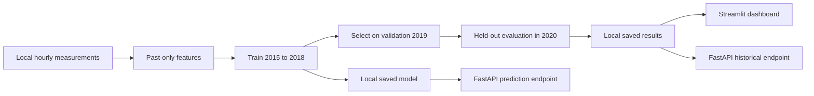

# Irish Energy Forecast AI

Hourly electricity demand forecasting for Ireland: 24 independent prediction
models, chronological evaluation, a Streamlit dashboard and a FastAPI service.

A personal engineering project developed during an exchange at Dublin City
University, following studies at ECE Bordeaux. The project focuses on avoiding
future-data leakage and reusing saved models across an interface and an API.

This public source edition contains original code, tests, the experiment protocol,
model configuration and aggregate error metrics. Source measurements, trained
models, individual forecast outputs, charts and screenshots are kept outside this
repository. The dashboard and prediction endpoints require local artifacts.

## Reference results

Random Forest was selected by validation MAE in 2019. It was trained on 2015 to
2018 and evaluated on January to June 2020, with no refit on validation.

| Method | Validation MAE (MW) | Validation RMSE (MW) | Test MAE (MW) | Test RMSE (MW) |
| --- | ---: | ---: | ---: | ---: |
| Previous day | 151.35 | 229.77 | 144.04 | 219.97 |
| Previous week | 118.62 | 190.03 | 120.93 | 174.18 |
| Ridge | 78.81 | 118.08 | Not evaluated | Not evaluated |
| Random Forest | 67.27 | 102.41 | 78.44 | 117.16 |
| HistGradientBoosting | 67.71 | 101.11 | Not evaluated | Not evaluated |

These are aggregate errors from the local reference experiment, preserved in the
[validation](reports/ml/validation_metrics.csv) and
[test](reports/ml/test_metrics.csv) tables. They are historical results, with no
guarantee on current demand. One configuration per model and one validation year
do not establish a statistically reliable ranking.

## How it works

At origin T, the inputs cover 169 hourly observations through T. Each of the 24
regressors predicts one target, T+1 through T+24, without feeding predictions into
later horizons. The 11 features combine past demand, past rolling averages,
seasonal references and the known UTC target calendar.

Incomplete examples are excluded without imputation. The final 24 candidate
origins of each period are excluded so targets stay inside their split. All models
use the same origins. See the [frozen protocol](reports/phase3_protocol.md).



| Location | Responsibility |
| --- | --- |
| `scripts/forecast_data.py` | Features, targets and chronological exclusions |
| `scripts/forecast_models.py` | Direct models and inference |
| `scripts/train_forecast.py`, `scripts/evaluate_test.py` | Separate selection and final test |
| `dashboard/` | Historical exploration, metrics and local CSV export |
| `api/main.py` | Input validation and four REST endpoints |
| `tests/` | Controlled tests and optional reference-artifact integration tests |

## Install and test

The reference environment uses Python 3.13.16 on Apple Silicon macOS.
From the repository root:

```bash
python3.13 -m venv .venv
source .venv/bin/activate
python -m pip install -r requirements-all.txt
python -W error::DeprecationWarning -m unittest discover -s tests -v
```

Controlled tests run without source data or model downloads. Tests requiring
reference data report explicit skips in this edition. Those skips are not evidence
that inference or the complete dashboard worked in a fresh clone. See
[verification and scope](docs/PUBLICATION_SCOPE.md) for the actual counts.
The test dependencies were available locally for preparation; a fresh online
installation on another machine has not been verified.

## Reproduce locally with appropriate source access

Source: [OPSD Time series, version 2020-10-06](https://data.open-power-system-data.org/time_series/2020-10-06),
using `IE_load_actual_entsoe_transparency` and UTC timestamps. The SEM market-area
series is separate. Read [provenance and rights](data/SOURCES.md) before acquiring,
using or redistributing source data.

With the environment activated, create an independent experiment. This preserves
the reference selection and test markers committed under `reports/ml/`.

```bash
python -m scripts.create_reproduction .reproductions/run-01
cd .reproductions/run-01
# Only after reviewing the applicable source terms:
python -m scripts.download_data
python -m scripts.explore_data
python -m scripts.analyze_patterns
python -m scripts.prepare_data
python -m scripts.train_forecast
python -m scripts.evaluate_test
python -m scripts.plot_forecast_results
python -m scripts.report_forecast_results
python -W error::DeprecationWarning -m unittest discover -s tests -v
```

Training is explicit. The dashboard, API and artifact downloader never start it.
The source downloader verifies the CSV against OPSD metadata. Allow several
hundred MB of storage plus training memory. Generated artifacts remain local and
must not be added to a public repository without checking their rights.

## Run the dashboard and API

After reproduction, stay in the experiment workspace with the environment active:

```bash
python -m streamlit run dashboard/app.py
```

Open `http://127.0.0.1:8501`. The dashboard includes Overview, Forecast Explorer,
Model Performance and Methodology. It reads saved historical predictions and does
not provide a live electricity service. With this source edition alone, it reports
missing artifacts instead of displaying a demonstration.

In a second terminal, activate the same environment and enter the same experiment:

```bash
python -m uvicorn api.main:app --host 127.0.0.1 --port 8000
```

| Endpoint | Purpose |
| --- | --- |
| `GET /health` | Artifact availability; 503 when required files are absent |
| `GET /model-info` | Features, horizons and model metadata |
| `GET /historical-forecast?origin_utc=2020-02-03T02:00:00Z` | Local saved forecast for a UTC origin |
| `POST /predict` | 24 forecasts from exactly 169 consecutive hourly inputs |

Swagger is at `http://127.0.0.1:8000/docs`. Requests require finite nonnegative
numeric demand, explicit UTC timestamps on whole hours and a final timestamp equal
to the origin. The service rejects gaps, duplicates, extra fields and missing
values. It has no authentication and is intended for local use. Load only trusted
joblib models; they can execute code during deserialization.

No pretrained download or hosted demonstration is available. The experimental
[artifact manifest](artifacts/manifest.json) and downloader remain disabled for
network downloads because distribution has not been approved.

## Limits and licensing

Hourly forecast origins overlap, so errors are correlated. The experiment assumes
that demand at T has been received; publication delays and revisions are not
simulated. Weather, Irish holidays, local daylight-saving time and prediction
intervals are outside this version.

Original code and documentation use the [MIT license](LICENSE). Dependencies
retain their [own licenses](THIRD_PARTY_NOTICES.md). That license grants no rights
over OPSD/ENTSO-E measurements. This edition redistributes aggregate evaluation
statistics and configuration, with no source observations, model binaries or
source-data visuals. See [publication scope](docs/PUBLICATION_SCOPE.md).
