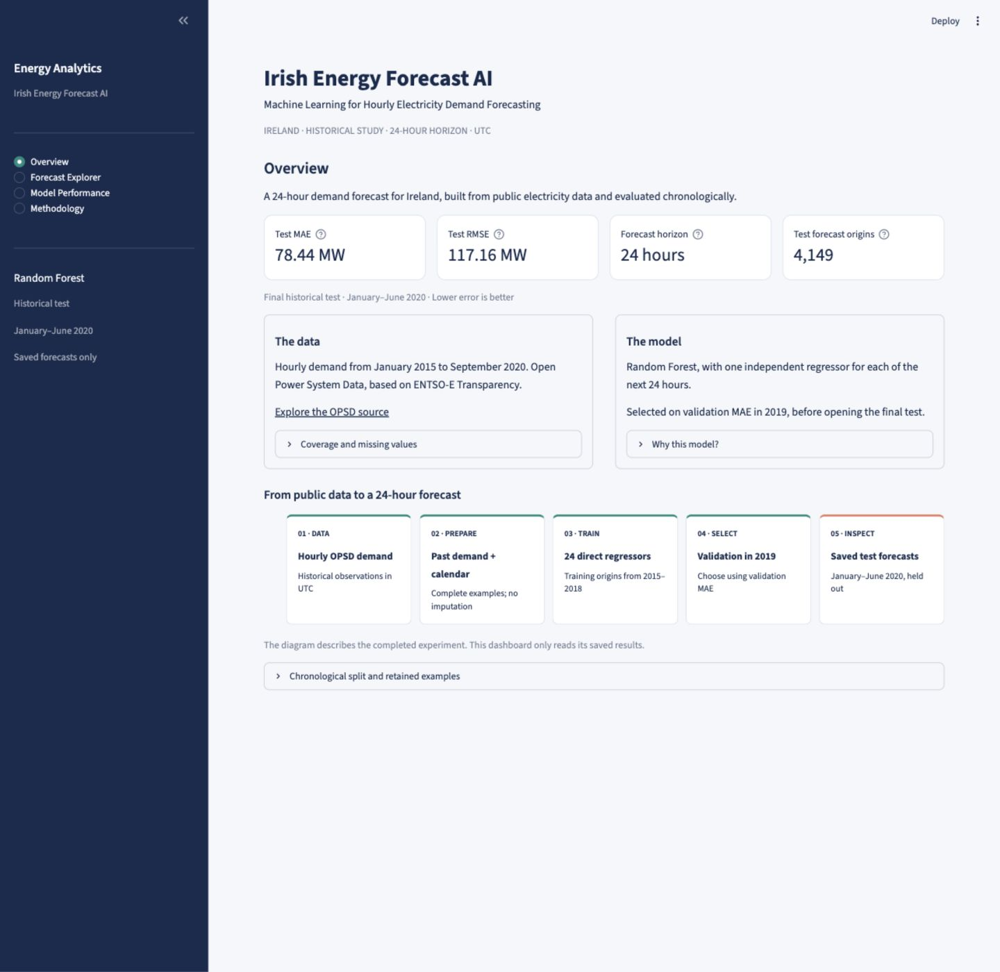
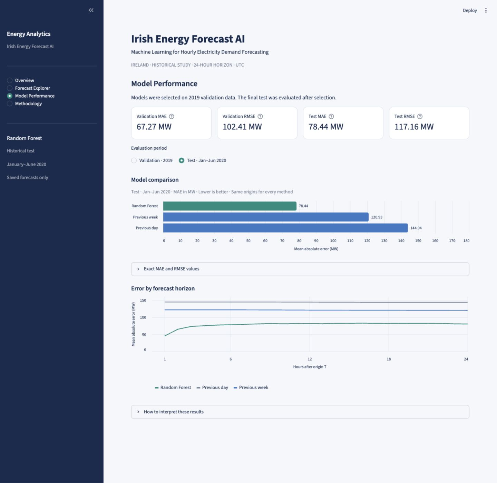
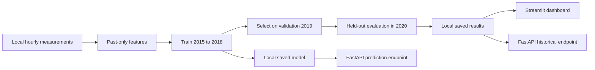
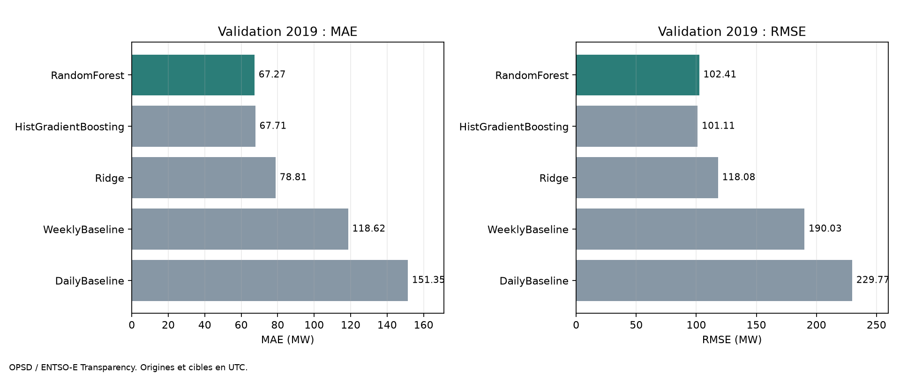
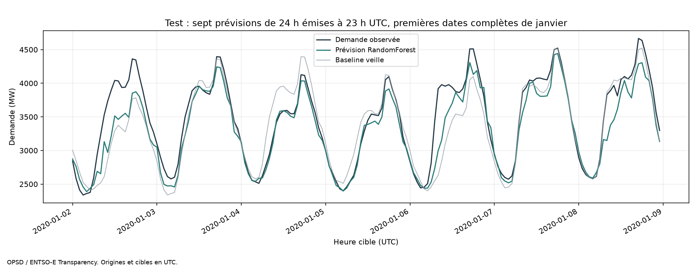

# Ireland electricity demand forecasting

[Try locally](#try-the-dashboard) · [Results](#reference-results) · [Model Release](https://github.com/Hugo-bordas/Ireland-Electricity-Demand-Forecasting/releases/tag/v1.0.0) · [Deployment assessment](docs/STREAMLIT_DEPLOYMENT.md)

Hourly electricity demand forecasting for Ireland: 24 independent prediction
models, chronological evaluation, a Streamlit dashboard and a FastAPI service.

A personal engineering project developed during an exchange at Dublin City
University, following studies at ECE Bordeaux. The project focuses on avoiding
future-data leakage and reusing saved models across an interface and an API.

Supported by EirGrid Group Data.

This non-commercial academic project includes the Irish historical dataset, saved
test forecasts, real dashboard screenshots and the original implementation.
EirGrid permission supplied by the owner expressly covers those materials and the
trained models for this project. See [data terms](docs/DATA_TERMS.md). The code is
MIT; that license does not relicense the data or model assets.

## At a glance

- Random Forest test MAE: **78.44 MW**, compared with **120.93 MW** for the previous-week baseline (35.1% lower MAE).
- Evaluation covers **4,149 forecast origins × 24 hours** in January–June 2020. Model selection uses 2019 validation data only.
- Explore the saved forecasts locally without training, credentials or the 161 MiB model download.



## Try the dashboard

Use Python 3.13 and Git. Run:

```bash
git clone https://github.com/Hugo-bordas/Ireland-Electricity-Demand-Forecasting.git
cd Ireland-Electricity-Demand-Forecasting
python3.13 -m venv .venv
source .venv/bin/activate
python -m pip install -r dashboard/requirements.txt
python -m streamlit run dashboard/app.py
```

On Windows, use `py -3.13 -m venv .venv` and `.venv\Scripts\Activate.ps1`
in PowerShell instead of the two environment commands above.
Open [localhost:8501](http://localhost:8501).

Start with **Forecast Explorer** to compare a saved 24-hour forecast with observed
demand and export its rows. Change the date and hour, then open **Model Performance**
to compare validation and test errors. Overview and Methodology explain the data
and chronological split. All 4,149 origins remain available, including large errors.

This is a historical demonstration, not a live demand service. No hosted demo is
currently verified. See the [Streamlit deployment assessment](docs/STREAMLIT_DEPLOYMENT.md)
for the proposed Community Cloud setup and remaining checks.

## Reference results

Random Forest was selected by validation MAE in 2019. It was trained on 2015 to
2018 and evaluated on January to June 2020, with no refit on validation.

| Method | Validation MAE (MW) | Validation RMSE (MW) | Test MAE (MW) | Test RMSE (MW) |
| --- | ---: | ---: | ---: | ---: |
| Previous day | 151.35 | 229.77 | 144.04 | 219.97 |
| Previous week | 118.62 | 190.03 | 120.93 | 174.18 |
| Ridge | 78.81 | 118.08 | Not evaluated | Not evaluated |
| Random Forest | 67.27 | 102.41 | 78.44 | 117.16 |
| HistGradientBoosting | 67.71 | 101.11 | Not evaluated | Not evaluated |

The 35.1% MAE reduction above is calculated against the previous-week test baseline
using the unrounded saved scores. The aggregate errors from the local reference
experiment are preserved in the
[validation](reports/ml/validation_metrics.csv) and
[test](reports/ml/test_metrics.csv) tables. They are historical results, with no
guarantee on current demand. One configuration per model and one validation year
do not establish a statistically reliable ranking.

## Dashboard screenshots

Captured from the actual Streamlit application using the reference results.


The selected forecast has MAE 64.35 MW; overall test MAE remains 78.44 MW.
The opening origin is closest to the median 24-hour MAE with chronological
tie-breaking. All 4,149 origins, including high-error forecasts, remain available.



## How it works

At origin T, the inputs cover 169 hourly observations through T. Each of the 24
regressors predicts one target, T+1 through T+24, without feeding predictions into
later horizons. The 11 features combine past demand, past rolling averages,
seasonal references and the known UTC target calendar.

Incomplete examples are excluded without imputation. The final 24 candidate
origins of each period are excluded so targets stay inside their split. All models
use the same origins. See the [frozen protocol](reports/phase3_protocol.md).



| Location | Responsibility |
| --- | --- |
| `scripts/forecast_data.py` | Features, targets and chronological exclusions |
| `scripts/forecast_models.py` | Direct models and inference |
| `scripts/train_forecast.py`, `scripts/evaluate_test.py` | Separate selection and final test |
| `dashboard/` | Historical exploration, metrics and local CSV export |
| `api/main.py` | Input validation and four REST endpoints |
| `tests/` | Controlled tests and optional reference-artifact integration tests |

<details>
<summary>Evaluation plots from the saved experiment</summary>





These figures use saved results. The test window follows a calendar and availability
rule fixed before evaluation. Neither display rule changes the experiment scores.

</details>

## Install and test

For the API, model reproduction and the complete test suite, activate the same
Python 3.13 environment and install the full dependencies. The reference
environment uses Python 3.13.16 on Apple Silicon macOS:

```bash
python -m pip install -r requirements-all.txt
python -W error::DeprecationWarning -m unittest discover -s tests -v
```

The historical dashboard and its tests use the included Irish data and forecasts.
Inference integration tests additionally need the large Random Forest model,
which is distributed as a separate Release asset. Missing-model tests report explicit
skips; see [verification and scope](docs/PUBLICATION_SCOPE.md) for the actual
counts. With the verified Release model and a fresh dependency installation,
all 80 tests passed.
A clean copy without that model passed 65 tests and explicitly skipped 15 API tests.
See the [portfolio verification record](docs/PORTFOLIO_VERIFICATION.md) for the
checks completed during this README update.

## Reproduce locally with appropriate source access

Source: [OPSD Time series, version 2020-10-06](https://data.open-power-system-data.org/time_series/2020-10-06),
using `IE_load_actual_entsoe_transparency` and UTC timestamps. The SEM market-area
series is separate. Read [provenance and rights](data/SOURCES.md) before acquiring,
using or redistributing source data.

With the environment activated, create an independent experiment. This preserves
the reference selection and test markers committed under `reports/ml/`.

```bash
python -m scripts.create_reproduction .reproductions/run-01
cd .reproductions/run-01
# Only after reviewing the applicable source terms:
python -m scripts.download_data
python -m scripts.explore_data
python -m scripts.analyze_patterns
python -m scripts.prepare_data
python -m scripts.train_forecast
python -m scripts.evaluate_test
python -m scripts.plot_forecast_results
python -m scripts.report_forecast_results
python -W error::DeprecationWarning -m unittest discover -s tests -v
```

To inspect an independent experiment, run `python -m streamlit run dashboard/app.py`
from that experiment workspace with the full environment activated.

Training is explicit. The dashboard, API and artifact downloader never start it.
The source downloader verifies the CSV against OPSD metadata. Allow several
hundred MB of storage plus training memory. Generated artifacts remain local.
The permission covers this project within the
[data terms](docs/DATA_TERMS.md); it does not authorize unrelated European data.

## Run the API

The reference Random Forest is about 161 MiB and is distributed in the
[v1.0.0 Release](https://github.com/Hugo-bordas/Ireland-Electricity-Demand-Forecasting/releases/tag/v1.0.0).
From the repository root, install the reviewed reference assets, then check them:

```bash
python -m scripts.download_artifacts --profile full --download
python -m scripts.download_artifacts --profile full --check
```

The downloader checks the pinned sizes and SHA-256 digests in the
[manifest](artifacts/manifest.json). It preserves existing files with different
contents and never loads a model or starts training. The Release also contains
`DATA_TERMS.md` and `SHA256SUMS`. Use the recorded dependency versions and reviewed
joblib assets from the project owner. No hosted API is provided.

Activate the full environment in the repository root, then start the API:

```bash
python -m uvicorn api.main:app --host 127.0.0.1 --port 8000
```

| Endpoint | Purpose |
| --- | --- |
| `GET /health` | Artifact availability; 503 when required files are absent |
| `GET /model-info` | Features, horizons and model metadata |
| `GET /historical-forecast?origin_utc=2020-02-03T02:00:00Z` | Local saved forecast for a UTC origin |
| `POST /predict` | 24 forecasts from exactly 169 consecutive hourly inputs |

Open [Swagger UI](http://127.0.0.1:8000/docs). Try `POST /predict` with the
included [169-hour example request](data/processed/phase3/example_request.json),
or send it from another terminal:

```bash
curl -X POST http://127.0.0.1:8000/predict \
  -H 'Content-Type: application/json' \
  --data-binary @data/processed/phase3/example_request.json
```

Requests require finite nonnegative numeric demand, explicit UTC timestamps on whole hours and a final timestamp equal
to the origin. The service rejects gaps, duplicates, extra fields and missing
values. It has no authentication and is intended for local use. Load only trusted
joblib models; they can execute code during deserialization.

## Limits and licensing

Hourly forecast origins overlap, so errors are correlated. The experiment assumes
that demand at T has been received; publication delays and revisions are not
simulated. Weather, Irish holidays, local daylight-saving time and prediction
intervals are outside this version.

Original code and documentation use the [MIT license](LICENSE). Dependencies
retain their [own licenses](THIRD_PARTY_NOTICES.md). Data, their visual
representations and model assets have separate conditions.
The owner-supplied EirGrid permission covers the stated Irish data and outputs for
this non-commercial, open-source academic project. Preserve attribution and
applicable terms; no commercial reuse right is claimed. The multi-country OPSD
CSV is excluded. See [data terms](docs/DATA_TERMS.md) and
[publication scope](docs/PUBLICATION_SCOPE.md).
