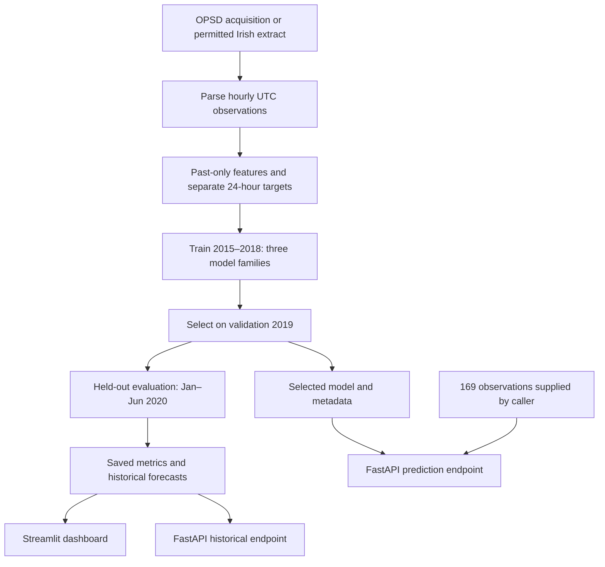
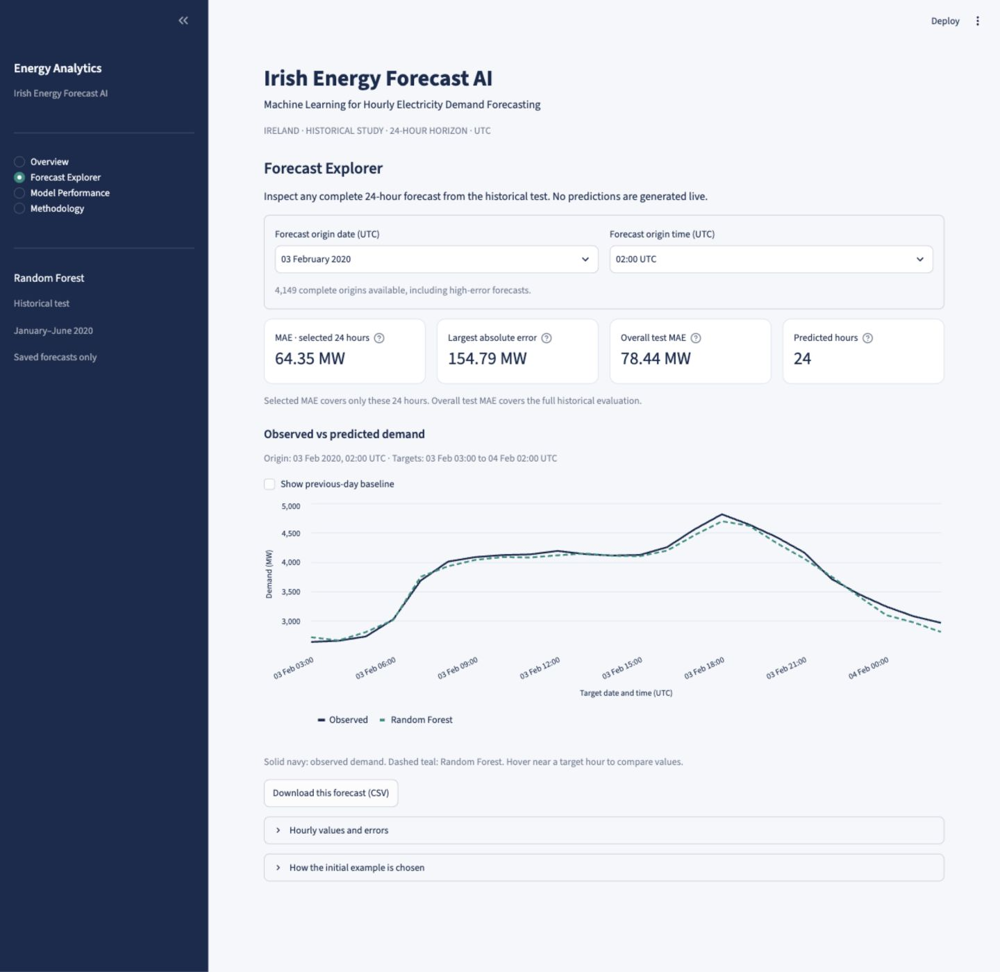

# Ireland Electricity Demand Forecasting — End-to-End Machine Learning Project

Forecast Ireland's hourly electricity demand up to 24 hours ahead, with chronological model evaluation, an interactive Streamlit dashboard and a FastAPI prediction interface.

A third-year engineering portfolio project at ECE Bordeaux, developed during an academic exchange at Dublin City University.


[](https://github.com/Hugo-bordas/Ireland-Electricity-Demand-Forecasting/actions/workflows/ci.yml)

[Open the live historical dashboard](https://ireland-electricity-demand-forecasting.streamlit.app/) · [Quick start](#quick-start) · [Results](#experimental-results) · [API guide](docs/API.md) · [Reproduce the experiment](docs/REPRODUCIBILITY.md) · [Model Release](https://github.com/Hugo-bordas/Ireland-Electricity-Demand-Forecasting/releases/tag/v1.0.0)


## Key results

| Historical out-of-sample test | Result |
| --- | ---: |
| Selected model | Random Forest |
| Forecast horizon | T+1 through T+24 hours |
| Test MAE / RMSE | **78.44 / 117.16 MW** |
| MAE reduction against previous-week baseline | **35.13%** |
| Evaluation period | January–June 2020 |
| Complete forecast origins | 4,149 |

Errors cover all 99,576 origin–horizon pairs, with equal weight. The dashboard displays these saved historical predictions. The API can run the saved model on user-supplied history; neither interface acquires live electricity data.

## Engineering problem

Electricity demand forecasts help inform generation scheduling and grid planning. This project studies how much a demand-and-calendar model improves on daily and weekly seasonal references, then makes its forecasts inspectable through a dashboard and reusable through an API.

A new forecast is simulated each hour, assuming demand at T has arrived. Publication delays, revisions and current-demand accuracy are outside the experiment.

## Machine learning methodology

- **Data:** the Irish `IE_load_actual_entsoe_transparency` series from [OPSD Time series 2020-10-06](https://data.open-power-system-data.org/time_series/2020-10-06/), sourced from EirGrid through ENTSO-E Transparency. Hourly interval-start timestamps are in UTC; demand is in MW.
- **Preparation:** retain the hourly grid and missing values. Exclude an origin if any required input or any of its 24 targets is missing; no imputation. Every method uses the same retained origins.
- **Features:** 11 inputs per horizon: UTC target hour, weekday, month and weekend; demand at T, T−24 and T−168; complete 24- and 168-hour means ending at T; seasonal references at T+h−24 and T+h−168. All observed inputs occur at or before T.
- **Strategy:** 24 independent regressors per model family, one for each horizon. Predictions are never fed into subsequent horizons. Inference requires 169 consecutive hourly observations through T.
- **Selection:** train on 2015–2018, select on 2019 validation MAE, then evaluate the selected model and baselines on January–June 2020. No refit on validation. Hyperparameters were fixed, with one configuration per family.
- **Leakage controls:** separate feature and target tables, train-only Ridge preprocessing, training/selection inputs truncated before 2020, and a 24-origin boundary purge so targets remain within their split. Saved selection, hashes and evaluation markers protect the reference run.

See the [reproduction guide](docs/REPRODUCIBILITY.md) and [original frozen protocol](reports/phase3_protocol.md) for exact parameters and exclusions. The protocol records the ML stage before the dashboard and API were added.

## Experimental results

| Method | Validation MAE | Validation RMSE | Test MAE | Test RMSE |
| --- | ---: | ---: | ---: | ---: |
| Previous day | 151.35 | 229.77 | 144.04 | 219.97 |
| Previous week | 118.62 | 190.03 | 120.93 | 174.18 |
| Ridge | 78.81 | 118.08 | Not evaluated | Not evaluated |
| **Random Forest** | **67.27** | **102.41** | **78.44** | **117.16** |
| HistGradientBoosting | 67.71 | 101.11 | Not evaluated | Not evaluated |

All errors are in MW; lower is better. HistGradientBoosting has a slightly lower validation RMSE, while Random Forest wins on the predefined selection metric, MAE. Only the selected model is tested. One validation year and one configuration per family do not establish a general or statistically reliable ranking.

Sources: saved [validation scores](reports/ml/validation_metrics.csv), [test scores](reports/ml/test_metrics.csv) and [split counts](reports/ml/split_counts.csv). The 35.13% improvement uses unrounded MAEs. Run `python -m scripts.verify_results` to recompute global and per-horizon test errors from all saved predictions without loading a model.

## Architecture



## Interactive dashboard

[Open the public demonstration](https://ireland-electricity-demand-forecasting.streamlit.app/). No installation or model download is needed.

Explore all complete historical origins, compare observed and predicted demand, show the daily baseline and export 24 forecast rows. Model Performance separates validation from test and plots errors by horizon. Overview and Methodology explain the experiment.

<details>
<summary>Forecast Explorer and Model Performance screenshots</summary>



The opening example has MAE 64.35 MW; global test MAE remains 78.44 MW. Its origin is closest to the median per-origin MAE, with chronological tie-breaking. High-error forecasts remain available.


Authentic application captures; additional [evaluation figures](reports/figures/) use saved outputs.

</details>

## Quick start

With Git and Python 3.13 installed:

```bash
git clone https://github.com/Hugo-bordas/Ireland-Electricity-Demand-Forecasting.git
cd Ireland-Electricity-Demand-Forecasting
python3.13 -m venv .venv
source .venv/bin/activate
python -m pip install -r dashboard/requirements.txt
python -m streamlit run dashboard/app.py --server.address 127.0.0.1
```

Open [localhost:8501](http://localhost:8501). On Windows PowerShell, use `py -3.13 -m venv .venv` and `.venv\Scripts\Activate.ps1` for environment creation and activation.

The dashboard needs only the eight saved files listed in [deployment documentation](docs/STREAMLIT_DEPLOYMENT.md#required-files). They are included in Git. No retraining, API server, model binary or private local file is needed.

## Prediction API

With the environment active, install and verify the [v1.0.0 model](https://github.com/Hugo-bordas/Ireland-Electricity-Demand-Forecasting/releases/tag/v1.0.0), then start the API:

```bash
python -m pip install -r requirements-all.txt
python -m scripts.download_artifacts --profile full --download
python -m scripts.download_artifacts --profile full --check
python -m uvicorn api.main:app --host 127.0.0.1 --port 8000
```

| Method and path | Input | JSON response |
| --- | --- | --- |
| `GET /health` | None | Readiness and artifact availability; 200 or 503 |
| `GET /model-info` | None | Model, 24 horizons, 11 features, versions and limitations |
| `GET /historical-forecast` | `origin_utc` query parameter | 24 saved forecast points with observations; 404 for an unavailable origin |
| `POST /predict` | Origin and exactly 169 consecutive UTC hourly observations | 24 new model predictions; no observed future demand |

[Swagger UI](http://127.0.0.1:8000/docs) describes the schema. Try:

```bash
curl -X POST http://127.0.0.1:8000/predict \
  -H 'Content-Type: application/json' \
  --data-binary @data/processed/phase3/example_request.json
```

See the [API guide](docs/API.md) for verified response examples, validation rules and errors. Inference is local, uses a historical model and provides no guarantee on recent demand. The API has no authentication; joblib assets must be trusted before loading.

## Reproducibility and tests

The [reproduction guide](docs/REPRODUCIBILITY.md) covers source acquisition through training, evaluation and comparison in an isolated workspace. The exploratory one-hour table is separate from the final 24-horizon training inputs.

```bash
python -m pip install -r requirements-all.txt
python -m scripts.verify_results
python -W error::DeprecationWarning -m unittest discover -s tests -v
```

See [completed checks](docs/PORTFOLIO_VERIFICATION.md). Linux CI verifies saved results and runs tests with 15 model-dependent API skips. Local validation with the verified model runs the full suite.

## Limitations and next steps

Successive forecast windows overlap, so their errors are correlated. Complete-case evaluation does not measure availability when inputs are missing. Publication delays and historical revisions are not simulated. Weather, Irish holidays, local daylight-saving time and prediction intervals are not modelled. Performance on current demand has not been established.

Possible extensions are walk-forward evaluation across more years, prediction intervals with coverage checks, and explicit treatment of measurement availability and revisions. These are future work.

## Data and licensing

Supported by EirGrid Group Data. Original source: EirGrid; publication source: ENTSO-E Transparency; data package: OPSD 2020-10-06. No endorsement is implied.

Original code and documentation use the [MIT license](LICENSE). Data and model assets have [separate terms](docs/DATA_TERMS.md), based on owner-supplied permission for this non-commercial academic project. Dependencies retain their [own licenses](THIRD_PARTY_NOTICES.md). The complete multi-country source CSV and private correspondence are excluded. See [provenance](data/SOURCES.md) and [publication scope](docs/PUBLICATION_SCOPE.md) before reuse.
